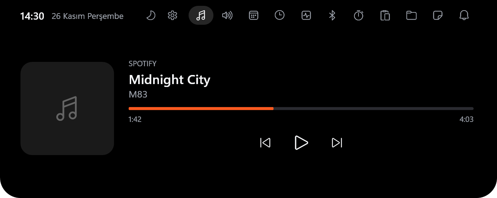
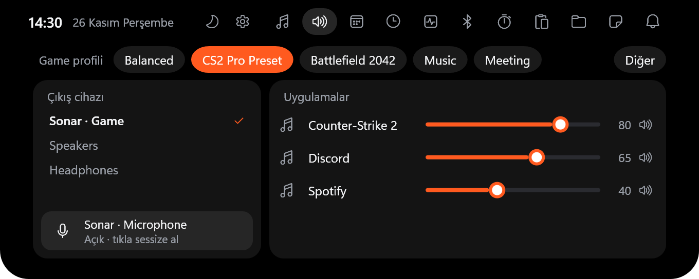
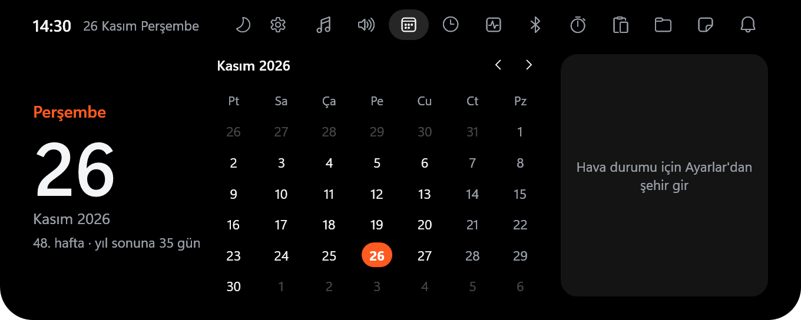
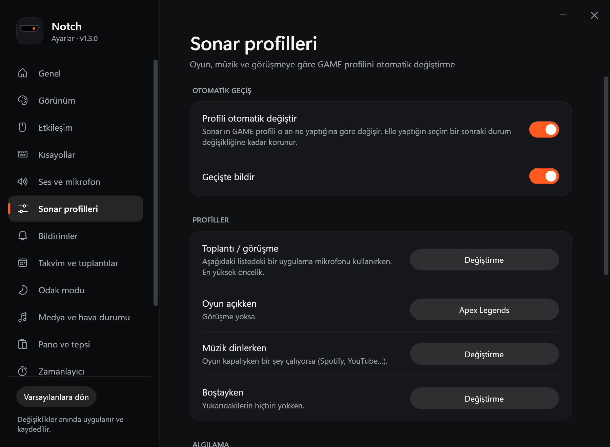

<h1 align="center">NotchHub for Windows</h1>

<p align="center">
  <b>A MacBook-style notch for Windows, turned into a live control center.</b><br>
  Music, audio, meetings, files, timers and alerts, one hover away.
</p>

<p align="center">
  <a href="https://github.com/atak946/NotchHub-Windows/releases/latest"></a>
  
  
  <a href="LICENSE"></a>
  <a href="https://github.com/atak946/NotchHub-Windows/actions/workflows/ci.yml"></a>
  <a href="https://github.com/atak946/NotchHub-Windows/releases"></a>
</p>

<p align="center">
  <a href="https://github.com/atak946/NotchHub-Windows/releases/latest/download/Notch.exe">
    
  </a>
</p>

<p align="center">
  
</p>

<p align="center">
  <b>English</b> · <a href="README.tr.md">Türkçe</a>
</p>

> Looking for macOS? See [NotchHub](https://github.com/atak946/NotchHub).
>
> The app's interface is currently **Turkish only**.

---

## ✨ At a glance

Rest the pointer on the top edge of the screen over the notch and it opens. Move away and it closes.
`Win+Alt+N` shows or hides it.

<table>
  <tr>
    <td width="50%" valign="top">
      
      <h3>🎚️ Audio</h3>
      Switch the output device, set per-app volume, mute the microphone and pick a SteelSeries Sonar
      profile.
    </td>
    <td width="50%" valign="top">
      
      <h3>📅 Calendar &amp; weather</h3>
      Month view and weather. An agenda tab shows classic Outlook events with join links and reminders.
    </td>
  </tr>
</table>

| | |
|---|---|
| 🎵 **Media** | Artwork, controls, seeking and synced lyrics |
| 📊 **System** | CPU, GPU, memory and disk, with temperature and space alerts |
| 🔋 **Devices** | Bluetooth battery levels and monitor brightness |
| ⏱️ **Timer** | Timers and Pomodoro cycles |
| 📋 **Clipboard** | Text history that skips password-like content |
| 🗂️ **Tray** | Drop files onto the notch and drag them out later |
| 📝 **Notes** | A quick plain-text note |
| 🔔 **Notifications** | Windows notifications in the notch, with history and a focus mode |
| 🎮 **Game HUD** | CPU, GPU, ping and optionally FPS in full-screen games |
| 🔊 **Volume HUD** | Replaces the Windows volume overlay |

## 🎧 SteelSeries Sonar

With Sonar running, the audio tab lists your favourite **GAME** profiles and all others. Automatic switching
(off by default) picks a profile for the current situation:

| Priority | Situation | How it is detected |
|---|---|---|
| 1 | Call | A listed app (Zoom, Teams, a browser…) is using the microphone |
| 2 | Game | A game from a Steam, Epic, Riot or similar library, or a borderless full-screen app |
| 3 | Music | Something is playing and no game is open |
| 4 | Idle | None of the above |

A profile you choose by hand stays until the situation changes. Apps are picked from a list, so you do not
need to know process names.

<p align="center">
  
</p>

Sonar's local API is undocumented, so a SteelSeries GG update may break this feature.

## 📦 Install

1. Download **Notch.exe** from [Releases](https://github.com/atak946/NotchHub-Windows/releases/latest).
2. Run it. To install it for your user (no administrator rights), open **Settings → Kurulum ve güncelleme**
   and choose **Bu bilgisayara kur**.

The executable is not signed with a Windows code-signing certificate, so SmartScreen may warn on first
launch. Updates are checked on startup against GitHub Releases and are installed only if their ECDSA
signature verifies. You can turn the check off in Settings.

**Requirements:** Windows 10 version 2004 or later, 64-bit. The release build includes .NET.

## 🔐 What the app accesses

| Access | Why |
|---|---|
| **Keyboard hook** | Handling the volume keys instead of the Windows overlay (can be turned off) |
| **Windows notification database** | Showing notifications in the notch; a working copy is kept in `%TEMP%\Notch-wpn` |
| **Notification banner setting** (optional) | Hiding Windows' own banners; restored when Notch closes |
| **Clipboard** | Clipboard history, kept in memory |
| **Outlook** (classic, optional) | Agenda and meeting reminders |
| **Downloads folder, microphone and camera state, network** | Alerts and indicators. Audio and video are never recorded |
| **Autostart** | Starting with Windows (can be turned off) |
| **Administrator rights** (optional) | Only for the FPS helper, installed as a scheduled task after a UAC prompt |

Antivirus software may flag an unsigned app that uses these.

## 🛡️ Privacy

- **Local data.** Settings, notes and the tray list stay in `%AppData%\Notch`.
- **No telemetry.** No analytics and no tracking.
- **Network calls:**
  - weather from [Open-Meteo](https://open-meteo.com), if you enter a city;
  - lyrics from [lrclib.net](https://lrclib.net), which receives the track and artist name (can be turned off);
  - a ping to the host you set (default `1.1.1.1`) while the game HUD is active;
  - the update check against this project's GitHub Releases (can be turned off);
  - the local SteelSeries GG API on `127.0.0.1`.

## 🛠️ Build from source

```powershell
dotnet build Notch.csproj -c Release
```

Releases and signing are covered in [docs/DEVELOPMENT.md](docs/DEVELOPMENT.md).

## 🤝 Contributing

Issues and pull requests are welcome. See [CONTRIBUTING.md](CONTRIBUTING.md). To report a security issue,
see [SECURITY.md](SECURITY.md).

## 📄 License

[MIT](LICENSE). Not affiliated with Apple or SteelSeries.
