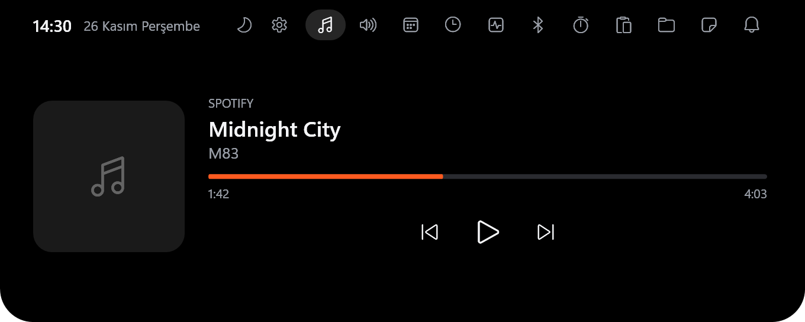
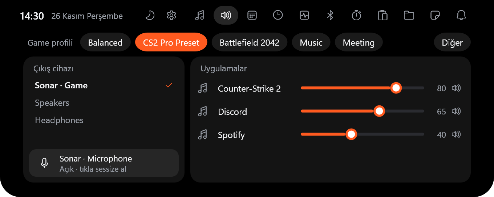
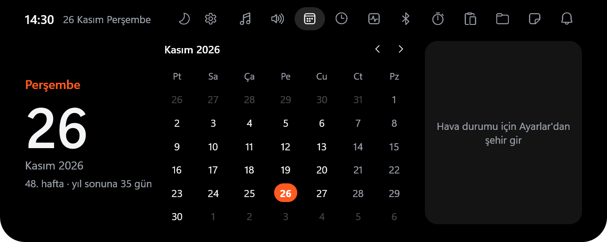
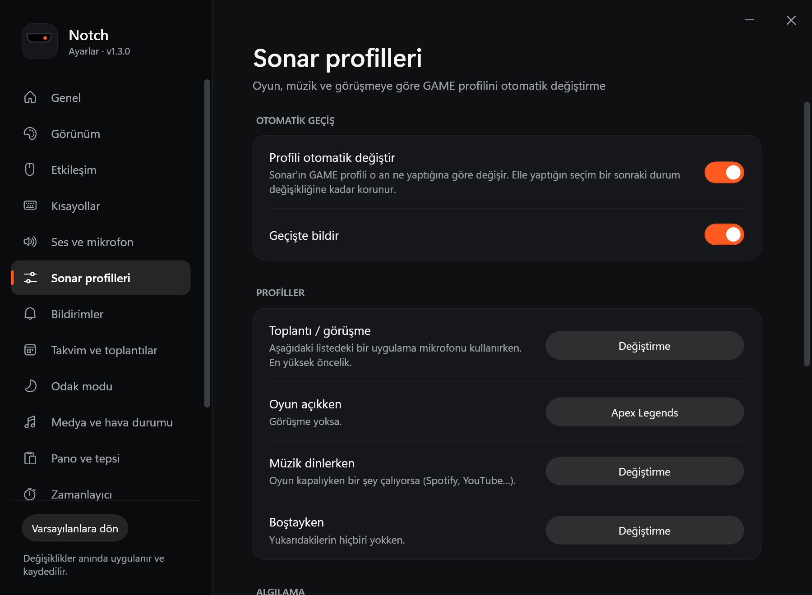

<h1 align="center">NotchHub for Windows</h1>

<p align="center">
  <b>Windows için MacBook tarzı bir çentik: canlı bir kontrol merkezi.</b><br>
  Müzik, ses, toplantılar, dosyalar, zamanlayıcı ve uyarılar; fareyi götürmen yeter.
</p>

<p align="center">
  <a href="https://github.com/atak946/NotchHub-Windows/releases/latest"></a>
  
  
  <a href="LICENSE"></a>
</p>

<p align="center">
  <a href="https://github.com/atak946/NotchHub-Windows/releases/latest/download/Notch.exe">
    
  </a>
</p>

<p align="center">
  
</p>

<p align="center">
  <a href="README.md">English</a> · <b>Türkçe</b>
</p>

> macOS mu arıyorsun? [NotchHub](https://github.com/atak946/NotchHub).

---

## ✨ Kısaca

Fareyi ekranın üst kenarında çentiğin üzerinde beklet, panel açılsın. Uzaklaşınca kapanır.
`Win+Alt+N` ile gösterip gizleyebilirsin.

<table>
  <tr>
    <td width="50%" valign="top">
      
      <h3>🎚️ Ses</h3>
      Çıkış cihazını değiştir, uygulama bazında sesi ayarla, mikrofonu sustur ve SteelSeries Sonar
      profili seç.
    </td>
    <td width="50%" valign="top">
      
      <h3>📅 Takvim ve hava</h3>
      Aylık görünüm ve hava durumu. Ajanda sekmesi klasik Outlook etkinliklerini katılma bağlantısı ve
      hatırlatmayla gösterir.
    </td>
  </tr>
</table>

| | |
|---|---|
| 🎵 **Medya** | Kapak, kontroller, ileri-geri sarma ve zamanlı şarkı sözleri |
| 📊 **Sistem** | CPU, GPU, bellek ve disk; sıcaklık ve boş alan uyarıları |
| 🔋 **Cihazlar** | Bluetooth pil seviyeleri ve monitör parlaklığı |
| ⏱️ **Zamanlayıcı** | Geri sayım ve Pomodoro |
| 📋 **Pano** | Şifreye benzeyen içerikleri atlayan metin geçmişi |
| 🗂️ **Tepsi** | Dosyaları çentiğe bırak, sonra sürükleyip al |
| 📝 **Notlar** | Hızlı düz metin notu |
| 🔔 **Bildirimler** | Windows bildirimleri, geçmiş ve odak modu |
| 🎮 **Oyun göstergesi** | Tam ekranda CPU, GPU, ping ve isteğe bağlı FPS |
| 🔊 **Ses göstergesi** | Windows ses kutusunun yerine geçer |

## 🎧 SteelSeries Sonar

Sonar çalışırken ses sekmesinde favori **GAME** profillerin ve diğerleri listelenir. Otomatik geçiş
(başlangıçta kapalı) duruma göre profil seçer:

| Öncelik | Durum | Nasıl algılanır |
|---|---|---|
| 1 | Görüşme | Listedeki bir uygulama (Zoom, Teams, tarayıcı…) mikrofonu kullanıyor |
| 2 | Oyun | Steam, Epic, Riot vb. kütüphanesinden bir oyun veya çerçevesiz tam ekran uygulama |
| 3 | Müzik | Oyun kapalıyken bir şey çalıyor |
| 4 | Boşta | Hiçbiri yok |

Elle seçtiğin profil durum değişene kadar korunur. Uygulamalar listeden seçilir; süreç adı bilmen gerekmez.

<p align="center">
  
</p>

Sonar'ın yerel API'si belgelenmemiştir; bir SteelSeries GG güncellemesi bu özelliği bozabilir.

## 📦 Kurulum

1. [Releases](https://github.com/atak946/NotchHub-Windows/releases/latest) sayfasından **Notch.exe** indir.
2. Çalıştır. Kendi kullanıcın için kurmak istersen (yönetici izni gerekmez) **Ayarlar → Kurulum ve
   güncelleme → Bu bilgisayara kur**.

Dosya bir Windows kod imzalama sertifikasıyla imzalı değildir; ilk açılışta SmartScreen uyarabilir.
Güncellemeler açılışta GitHub Releases'ten denetlenir ve yalnızca ECDSA imzası doğrulanırsa kurulur.
Denetimi ayarlardan kapatabilirsin.

**Gereksinim:** Windows 10 sürüm 2004 veya üstü, 64 bit. Yayın sürümü .NET'i içinde getirir.

## 🔐 Uygulamanın eriştikleri

| Erişim | Neden |
|---|---|
| **Klavye kancası** | Ses tuşlarını Windows kutusu yerine yönetmek (kapatılabilir) |
| **Windows bildirim veritabanı** | Bildirimleri çentikte göstermek; çalışma kopyası `%TEMP%\Notch-wpn` içinde tutulur |
| **Bildirim kutusu ayarı** (isteğe bağlı) | Windows'un kutularını gizlemek; Notch kapanınca geri alınır |
| **Pano** | Pano geçmişi, yalnızca bellekte |
| **Outlook** (klasik, isteğe bağlı) | Ajanda ve toplantı hatırlatmaları |
| **İndirilenler, mikrofon ve kamera durumu, ağ** | Uyarılar ve göstergeler. Ses ve görüntü kaydedilmez |
| **Otomatik başlatma** | Windows ile açılmak (kapatılabilir) |
| **Yönetici izni** (isteğe bağlı) | Yalnızca FPS yardımcısı için; UAC onayından sonra zamanlanmış görev olarak kurulur |

Bu erişimleri kullanan imzasız bir uygulamayı antivirüs programları işaretleyebilir.

## 🛡️ Gizlilik

- **Yerel veri.** Ayarlar, notlar ve tepsi listesi `%AppData%\Notch` içinde kalır.
- **Telemetri yok.** Analitik veya izleme yoktur.
- **Ağ istekleri:**
  - şehir girersen [Open-Meteo](https://open-meteo.com)'dan hava durumu;
  - [lrclib.net](https://lrclib.net)'ten şarkı sözü; şarkı ve sanatçı adı gönderilir (kapatılabilir);
  - oyun göstergesi açıkken belirlediğin adrese ping (varsayılan `1.1.1.1`);
  - bu projenin GitHub Releases sayfasından güncelleme denetimi (kapatılabilir);
  - `127.0.0.1` üzerindeki yerel SteelSeries GG API'si.

## 🛠️ Kaynaktan derleme

```powershell
dotnet build Notch.csproj -c Release
```

Yayınlama ve imzalama için [docs/DEVELOPMENT.md](docs/DEVELOPMENT.md).

## 🤝 Katkı

Issue ve pull request'ler memnuniyetle karşılanır: [CONTRIBUTING.md](CONTRIBUTING.md). Güvenlik sorunu
bildirmek için [SECURITY.md](SECURITY.md).

## 📄 Lisans

[MIT](LICENSE). Apple veya SteelSeries ile bağlantılı değildir.
